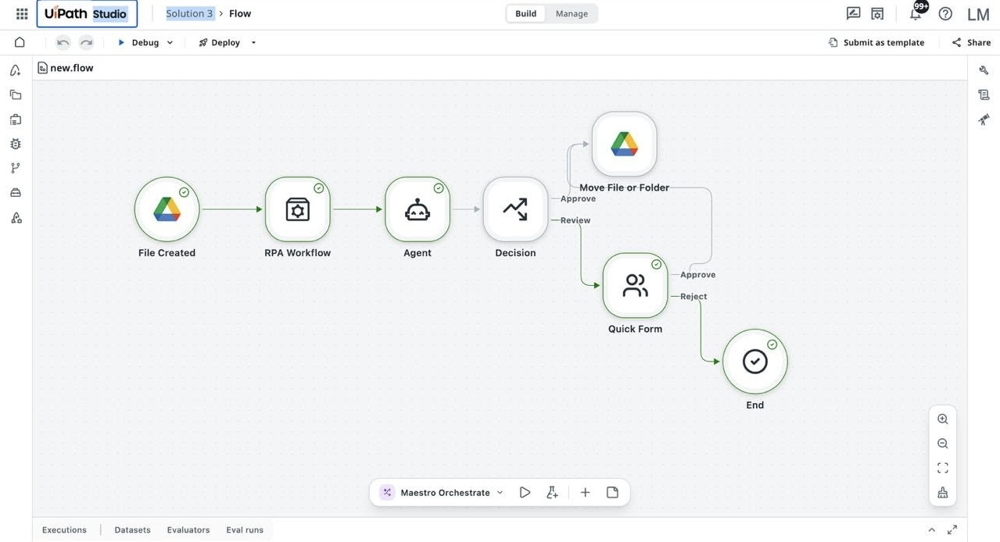
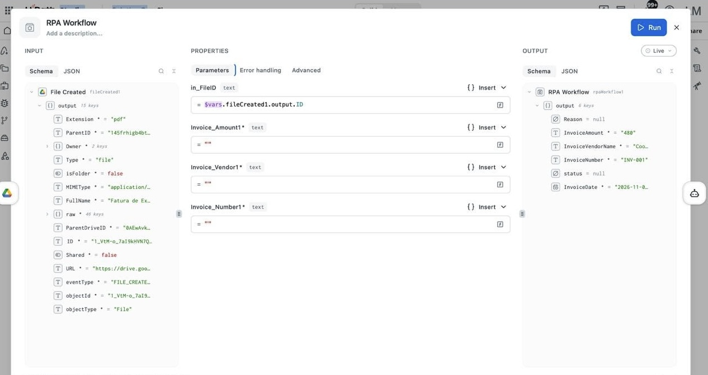
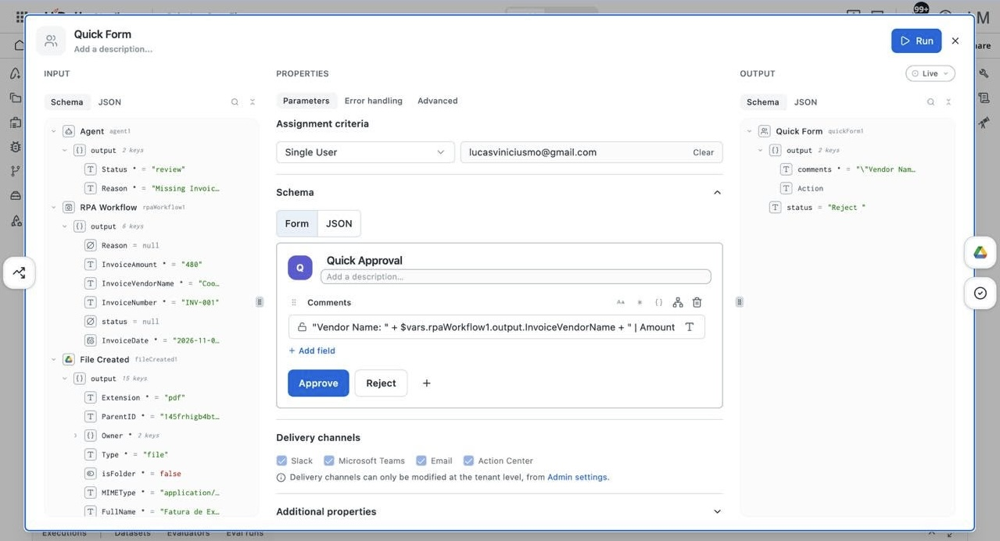

# Automação de Faturas com UiPath Studio Web e Action Center

Projeto de RPA desenvolvido no UiPath Cloud para automatizar a receção, extração de dados e validação de faturas a partir do Google Drive, utilizando arquitetura Human-in-the-Loop (HITL) para revisão manual de exceções.

## Problema e Objetivo

A triagem manual de faturas em PDF gera atrasos e erros de digitação na entrada de dados financeiros. Este fluxo automatiza a leitura dos documentos assim que chegam a uma pasta do Google Drive, valida as informações extraídas e encaminha apenas os casos duvidosos para aprovação humana antes de organizar os ficheiros aprovados.

## Fluxo do Processo

1. **Trigger (Google Drive):** O fluxo inicia automaticamente quando um novo ficheiro é carregado na pasta monitorizada (`File Created`).
2. **Extração de Dados (RPA Workflow):** O documento é processado pelo módulo de extração para capturar o fornecedor, número da fatura, valor total e data.
3. **Análise e Decisão:** Um agente avalia os dados extraídos. Se a fatura cumprir os critérios, segue direto para a pasta de aprovados. Caso contrário, segue para revisão.
4. **Revisão Humana (Action Center):** Faturas pendentes geram uma tarefa num *Quick Form* para aprovação ou rejeição manual.
5. **Organização de Ficheiros:** Após a decisão (automática ou manual), o ficheiro original é movido para a pasta final correspondente no Google Drive.

## Estrutura de Dados e Mapeamento

A comunicação entre o gatilho do Google Drive e o workflow de extração é feita através de argumentos tipados em .NET:

* **Entrada:**
  * `in_FileID` (String): ID do ficheiro gerado pelo evento do Google Drive (`$vars.fileCreated1.output.ID`).
* **Saída (Output do RPA Workflow):**
  * `InvoiceVendorName` (String): Nome do fornecedor.
  * `InvoiceNumber` (String): Número de identificação da fatura.
  * `InvoiceAmount` (String/Decimal): Valor total extraído.
  * `InvoiceDate` (DateTime): Data de emissão do documento.

## Validação Humana (Human-in-the-Loop)

Quando o fluxo entra na rota de revisão (`Review`), é gerado um formulário no Action Center atribuído ao utilizador responsável. O campo de descrição consolida os dados extraídos através de expressões diretas (`$vars.rpaWorkflow1.output.InvoiceVendorName` e `InvoiceAmount`), permitindo aprovar ou rejeitar a fatura sem precisar abrir o PDF original.

## Tecnologias Utilizadas

* **UiPath Studio Web** (Orquestração do fluxo principal e integrações Cloud)
* **UiPath Action Center** (Quick Forms para tarefas Human-in-the-Loop)
* **Google Workspace Integration** (Google Drive API para eventos e manipulação de ficheiros)
* **Expressões .NET / C#** (Manipulação de variáveis, tipagem e passagem de argumentos)

## Como Importar o Projeto

1. Faça o download do ficheiro `Invoice_Processing_solution.uis` disponível neste repositório.
2. Aceda ao [UiPath Studio Web](https://cloud.uipath.com/).
3. No painel de projetos, selecione a opção **Import** e carregue o ficheiro `.uis`.
4. Reconfigure as conexões da sua conta Google Drive e o utilizador de destino no bloco *Quick Form* antes de executar.
